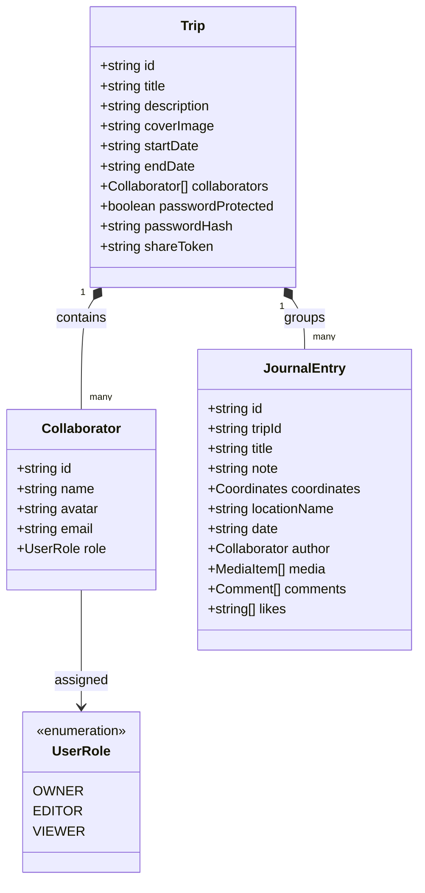
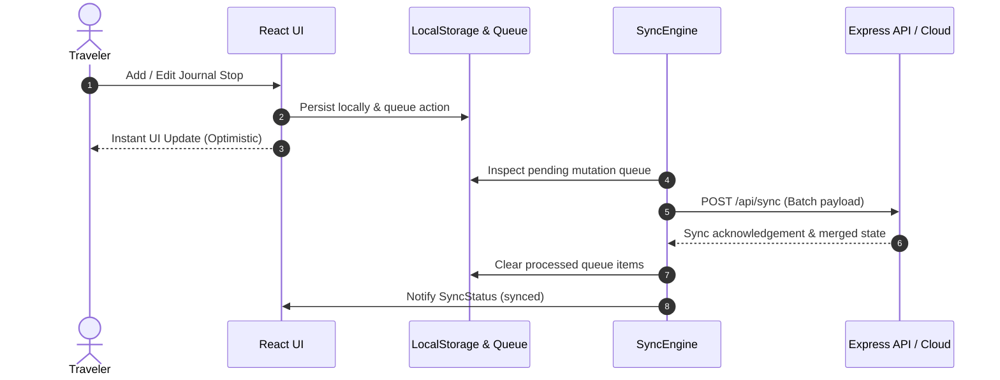
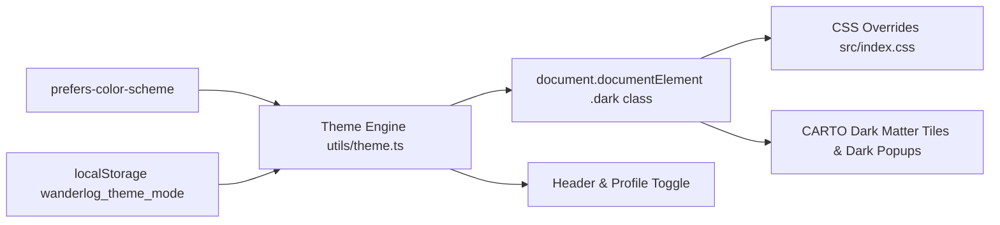

# WanderLog — System Architecture & Design Documentation

## 1. System Overview

**WanderLog** is a privacy-first, collaborative travel journal and map exploration web application. It allows travelers to record journeys, map visited waypoints, upload photos and media, manage itineraries, and collaborate with travel companions using a robust Role-Based Access Control (RBAC) model.

```mermaid
graph TD
    subgraph Client [Client Application - React 19 + Tailwind CSS]
        UI[App Entry & UI Views]
        Header[Header & Trip Switcher + Version Tag]
        Map[Leaflet TravelMap]
        Timeline[Timeline & Sorting]
        Modals[TripModal / EntryModal / ChangelogModal]
        
        RBAC[Permissions Engine utils/permissions.ts]
        Storage[Offline LocalStorage Engine]
        SyncClient[Sync Engine & Queue]
    end

    subgraph Backend [Server-Side Services - Express & REST]
        Server[Express Server server.ts]
        APITrips[/api/trips REST endpoints]
        APIEntries[/api/entries REST endpoints]
        APISync[/api/sync delta processing]
        StaticServing[Vite Middleware / Static Asset Server]
    end

    subgraph Security [Security & Permissions Boundary]
        RBAC_Owner[Owner Role: Full Admin & Collaborator Management]
        RBAC_Editor[Editor Role: Add/Edit Memories & Upload Media]
        RBAC_Viewer[Viewer Role: Read-Only Map & Chronicle Access]
    end

    UI --> Header
    UI --> Map
    UI --> Timeline
    UI --> Modals

    Modals --> RBAC
    Header --> RBAC
    Timeline --> RBAC

    UI --> Storage
    Storage --> SyncClient
    SyncClient <--> APISync
    UI <--> APITrips
    UI <--> APIEntries
    Server --> StaticServing
```

---

## 2. Role-Based Access Control (RBAC) Architecture

WanderLog uses a decentralized permission model embedded within each trip document:



### Permission Matrix

| Capability | Owner (`owner`) | Editor (`editor`) | Viewer (`viewer`) |
| :--- | :---: | :---: | :---: |
| **View Map, Timeline, Gallery, Stats** | ✅ | ✅ | ✅ |
| **Add New Stops & Memories** | ✅ | ✅ | ❌ |
| **Edit Existing Entries & Photos** | ✅ | ✅ | ❌ |
| **Reorder Itinerary Waypoints** | ✅ | ✅ | ❌ |
| **Delete Entries** | ✅ | ✅ (Own / Collab) | ❌ |
| **Invite & Add Collaborators** | ✅ | ❌ | ❌ |
| **Change Collaborator Roles** | ✅ | ❌ | ❌ |
| **Remove Collaborators** | ✅ (Protected) | ❌ | ❌ |
| **Edit Trip Settings & Password** | ✅ | ❌ | ❌ |
| **Delete Whole Trip** | ✅ | ❌ | ❌ |

---

## 3. Data Synchronization & Offline-First Flow



---

## 4. Architectural Decision Records (ADRs)

Refer to `/docs/adr/` for specific decisions:
- [ADR 001: Decentralized Role-Based Access Control for Travel Collaboration](adr/001-role-based-access-control.md)
- [ADR 002: Global Dark Mode Theming Architecture](adr/002-dark-mode-theming.md)

---

## 5. Theming & Dark Mode System


